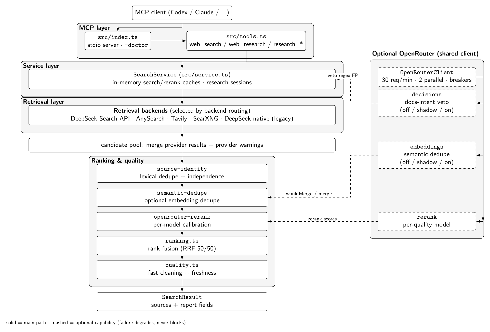
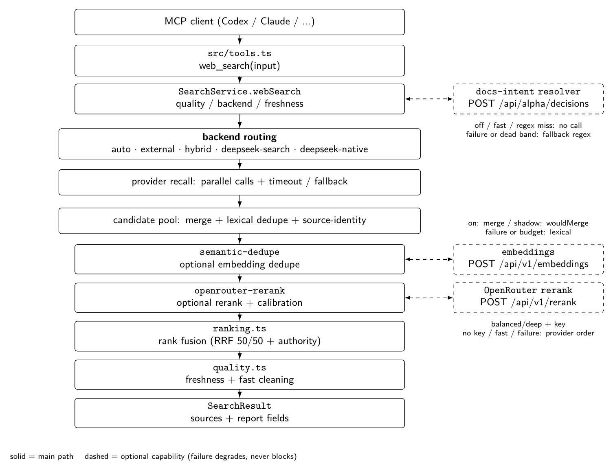
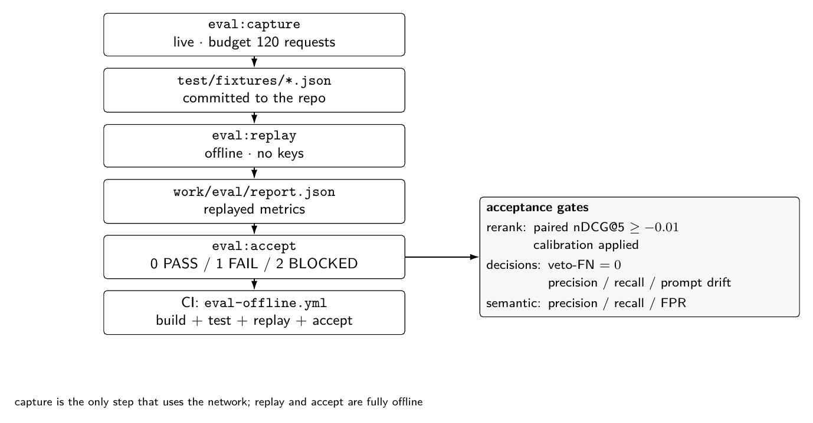

# DeepSeek Web Search MCP

[](https://m8ven.ai/mcp/zouyuanqing/deepseek-web-search-mcp)

一个独立的 stdio MCP 服务器，向 Codex 等客户端暴露搜索、研究和多轮研究工具：

- `web_search`：原生检索调用 DeepSeek 官方 Search API
  （`POST /v1/tools/search`），返回结构化来源、不含模型回答；也可与 AnySearch、
  SearXNG、Tavily 外部源合并为同一候选池，再统一去重、融合和排序。旧的
  Anthropic Messages 原生搜索路径（`deepseek-native`）保留兼容。
- `web_research`：通过 DeepSeek 官方 Anthropic 兼容 Messages API 调用
  `web_search_20250305`，返回回答、结构化来源和引用摘要（legacy 研究路径）。
- `research_start` / `research_followup` / `research_close`：带 TTL 和最大轮数的
  内存研究 session，用于多轮追问。

v1.7.0 起可在 `balanced` / `deep` 路径上可选接入 OpenRouter 模型能力：重排分数标定
（默认启用）、docs-intent veto（默认关闭）和语义转载折叠（默认关闭）。三者互不
依赖：重排会随 `quality` 或缺少 key 自动跳过，决策与嵌入另有显式 `off` 开关；
未配置 `OPENROUTER_API_KEY` 时三者自动跳过，搜索退回纯检索行为（重排报告
`applied: false`）。

## 架构

> 架构图由 LaTeX/TikZ 绘制（源文件在 [docs/diagrams](docs/diagrams/)），GitHub 直接显示 PNG。

### 分层架构



> LaTeX/TikZ 源文件：[`docs/diagrams/architecture.tex`](docs/diagrams/architecture.tex)

### `web_search` 请求流程



> LaTeX/TikZ 源文件：[`docs/diagrams/request-flow.tex`](docs/diagrams/request-flow.tex)

### 模块地图

| 层 | 主要文件 |
| --- | --- |
| MCP 入口与工具 | `src/index.ts`、`src/tools.ts` |
| 编排与缓存 | `src/service.ts`、`src/cache.ts`、`src/research-session.ts` |
| 检索 provider | `src/providers/`（DeepSeek Search、AnySearch、Tavily、SearXNG、DeepSeek native） |
| 排序与质量 | `src/ranking.ts`、`src/rerank-calibration.ts`、`src/quality.ts`、`src/source-identity.ts`、`src/semantic-dedupe.ts` |
| 可选 OpenRouter | `src/providers/openrouter-client.ts`、`openrouter-rerank.ts`、`openrouter-decisions.ts`、`openrouter-embed.ts`、`src/docs-intent.ts` |
| 配置与类型 | `src/config.ts`、`src/types.ts`、`src/errors.ts` |
| 评估 | `scripts/eval/`、`test/fixtures/`、`.github/workflows/eval-offline.yml` |

### 关键设计约束

- **先召回、后统一排序**：所有 provider 的结果进入同一候选池，再做去重与 rank fusion，避免单家排序偏置。
- **增强能力默认不改变基础行为**：rerank 在 `fast`、无 key 或失败时直接跳过；decisions 与 embedding 默认 `off`；flags-off 的 fast 搜索与 v1.6.0 逐字节一致。
- **失败只降级、不阻断**：rerank 失败回到 provider 顺序，decisions 失败回到正则，embedding 失败回到词法去重，搜索本身不因 OpenRouter 故障失败。
- **校准与模型解耦**：provider 只返回原始 rerank 分数，min-max/weak-signal 校准在 ranking 层完成，便于按模型选择 `auto` 策略。
- **共享客户端**：rerank / decisions / embeddings 共用一个 `OpenRouterClient`，统一限流、并发与熔断，避免三个模块各自打爆配额。


## DeepSeek 协议

DeepSeek 自 2026-10-17 起开放官方 Search & Fetch API。v1.6.0 起，`web_search`
新增官方 Search API 后端（`deepseek-search`），并成为默认 `auto` / `hybrid` 中
唯一的 DeepSeek 原生检索来源；旧的模型搜索保留为 legacy `deepseek-native`。

官方 Search API 直接返回结构化结果，不经过模型、不产生模型轮次：

```text
POST https://api.deepseek.com/v1/tools/search
```

需要模型撰写回答的场景仍走 Anthropic 兼容 Messages API：

```text
POST https://api.deepseek.com/anthropic/v1/messages
```

请求使用 `web_search_20250305` 服务端工具，返回模型回答、
`web_search_tool_result` 块和 citations。只有响应中存在
`web_search_tool_result` 才视为搜索成功；DSML、模型自述或普通文本都不能作为
搜索成功证据。`web_research` 与 `research_start` / `research_followup` 继续
使用这条路径；显式 `backend: "deepseek-native"` 也仍走它，用于兼容旧客户端。
Fetch 端点本项目不调用，也不注册为 MCP 工具。

| 路径 | 端点 | 使用场景 |
| --- | --- | --- |
| 官方 Search API（推荐） | `POST https://api.deepseek.com/v1/tools/search` | `web_search(backend="deepseek-search")`、`hybrid` 候选池、默认 `auto` |
| Anthropic 兼容 Messages API（legacy） | `POST https://api.deepseek.com/anthropic/v1/messages` | `web_research`、`research_*`、显式 `deepseek-native` |

Responses API 现已支持 `deepseek-v4-pro` 的服务端 `web_search_call`，但本项目不
使用 Responses API；旧版 README 中"Responses API 会静默忽略 `web_search`"的说法
只描述当时状态，不再是当前事实。

Messages 路径的实现契约参考 DeepSeek 官方 Harness 的
`@deepseek-ai/dsh-web-search-deepseek` 包。

仓库不包含 API Key、服务器地址、用户名或私钥。所有凭据均从进程环境读取。

## DeepSeek 官方 Search API

`web_search(backend="deepseek-search")` 直接调用官方 Search API，只做检索和结果
归一化，不产生模型回答。

### 请求与响应

端点：`POST https://api.deepseek.com/v1/tools/search`

请求头：

```text
Authorization: Bearer <DEEPSEEK_API_KEY>
Content-Type: application/json
```

请求示例：

```json
{
  "query": "site:api-docs.deepseek.com after:2026-01-01 DeepSeek search API",
  "count": 5,
  "need_content": false
}
```

| 字段 | 类型 | 说明 |
| --- | --- | --- |
| `query` | string，必填 | 1–128 个 Unicode 字符，不能全为空白，支持查询运算符 |
| `count` | integer | 返回条数，1–50，默认 10；不影响计费 |
| `ori_question` | string | 可选，原始问题，1–128 个字符 |
| `localization` | string | 可选，IP 形式的地域提示 |
| `need_content` | boolean | 默认 `false`；为 `false` 时结果中的 `content` 始终为空 |

本项目当前只发送 `query`、`count`（由 `max_results` 与 `quality` 的每路候选
上限共同决定）和 `need_content`；
`ori_question` 与 `localization` 是官方 API 的可用字段，尚未暴露为工具参数。

当 `DEEPSEEK_SEARCH_NEED_CONTENT=on` 时，响应中的页面正文 `content`（Markdown，
保留换行）会原样映射为来源的 `content` 字段；响应体积可能明显变大，单价不变。

query 超过 128 字符时会被截断到上限；需要附加 freshness 的 `after:` 运算符时，
按包含运算符的总长度 128 字符截断。发生截断时返回的 `warnings` 会说明。

响应示例：

```json
{
  "results": [
    {
      "rerank_score": 2.31,
      "title": "DeepSeek Search API",
      "url": "https://api-docs.deepseek.com/guides/search",
      "snippet": "…100–200 字符摘要…",
      "summary": "…600–800 字符摘要…",
      "content": "",
      "site_name": "DeepSeek API Docs",
      "site_icon": "https://api-docs.deepseek.com/favicon.ico",
      "date": "2026-10-17T00:00:00Z",
      "authority": 4
    }
  ]
}
```

- `rerank_score`：0–3，`>= 1.5` 视为高质量
- `snippet` 约 100–200 字符，`summary` 约 600–800 字符
- `date`：RFC3339 UTC 或 `null`
- `authority`：0–4 的权威性分级；`-1` 表示未知，`>= 3` 视为高权威，该分级会
  作为来源权威性信号参与 fast 清洗与 rank fusion；它只在聚合站/内容农场显式
  名单之后生效，不会把名单内域名重新提升为权威来源
- `results` 为空数组表示正常无匹配，不是错误

### 查询运算符

- `site:` / `-site:`：限定 / 排除站点
- `-term`：排除包含该词的页面
- `"exact phrase"` / `-"exact phrase"`：精确短语及其排除
- `lang:zh,en`：限定语言
- `after:2025` / `after:2025-01-01`：起始时间
- `before:2026` / `before:2026-06-01`：结束时间

`freshness` 的 `day` / `week` / `month` / `year` 会翻译为服务端
`after:YYYY-MM-DD` 运算符。

### 计费

- Search 与 Fetch 分别按 **$0.75 / 1,000 次成功请求** 计费。
- 只有 HTTP 200 且返回结果的请求计费；失败请求、空搜索结果和超时不计费。
- `count` 不影响单价。
- 通过 DeepSeek Harness、Claude Code、Codex 等服务端工具发起的请求同样按成功
  请求计费。

### 限流

账号级配额：Search 100 QPS、Fetch 25 QPS，两者额度独立；超限返回 429。

### 错误处理

错误响应使用 OpenAI 兼容格式。HTTP 状态码与建议处理：

| 状态 | 含义 | 处理 |
| --- | --- | --- |
| 400 | 请求非法 | 修正请求，不重试 |
| 401 | API Key 缺失或无效 | 修正凭据，不重试 |
| 402 | 余额不足 | 充值后重试 |
| 403 | Fetch 安全策略拒绝 | 不重试 |
| 404 | Fetch 无法获取目标 | 不重试 |
| 408 | 读取请求体超时 | 等待后重试 |
| 413 | 响应体过大 | 不重试 |
| 429 | QPS 超限 | 等待后重试 |
| 500 | 内部错误 | 等待后重试 |
| 504 | 下游超时 | 等待后重试 |

处理原则：408 / 429 / 5xx 等待并退避重试；402 充值；其他 4xx 不要重试。本项目
不自动重试：单独使用 `deepseek-search` 时会直接返回该 provider 的错误，并保留
`code`、HTTP `status` 与 `retryable` 元数据；在 `hybrid` / `auto` 中单个
provider 失败不会丢掉其他 provider 的结果。成功但无匹配时返回 `no_results`，提示
`No search results`，而不是误报"所有 provider 失败"。本项目只集成 Search；403、
404、413 是 Fetch 端点的状态码，此处按官方统一错误码表列出，供参考。

## 构建

```powershell
npm install
npm run build
npm test
```

质量计划的离线 replay 使用无密钥 fixture，不会调用线上 provider：

```powershell
npm run quality:fixture
npm run quality:replay
```

fixture 生成 70 个分层 synthetic query（30 development / 40 held-out）；结果写入
`work/quality/baseline-report.json`。
fixture 保存各 provider 的原始顺序、
状态、延迟、来源和可选 rerank 结果，用于比较当前 baseline 与 provider-aware RRF
shadow challenger；synthetic 数据只用于工程回归，不替代人工 relevance 标注，
shadow 结果不会改变 MCP 生产返回。

`npm run quality:summary` 打印各方法聚合指标和分类明细；`npm run quality:diff`
列出清洗后 nDCG@5 下降的具体 case；`node scripts/quality-inspect.mjs <caseId>`
打印单个 case 的输入、保留和被丢弃的来源。

除 `official` / `current` / `ambiguous` / `exploratory` 四类外，fixture 还包含两类
专门复现实测反馈的 held-out case：

- `syndication`：同一篇文章的 `/it/`、`/ar/`、`/en/` 多语言副本 + 跨域转载
- `aggregator-dominance`：聚合站排在官方文档页之前，且 rerank 给出与线上实测
  一致的低分（官方页 0.037 / 0.006）

需要采集真实四路原始运行时数据时执行：

```powershell
npm run quality:capture -- "your query"
```

结果写入被 `.gitignore` 排除的 `work/quality/runtime/latest.json`，不会把真实
provider 响应或凭据提交到仓库。

## 配置

复制 `.env.example` 中的变量到进程环境或 Windows 用户环境。至少需要：

- `DEEPSEEK_API_KEY`：`web_search(backend="deepseek-search")`、
  `web_search(backend="hybrid")` 的 DeepSeek 部分、`web_search(backend="deepseek-native")`、
  `web_research` 和 `research_*`。显式 `hybrid` 但未配置 key 时仍会返回外部
  provider 结果，并给出 `deepseek-search` 缺少凭据的 warning
- `WEB_SEARCH_BACKEND`：`web_search` 的默认后端，可选 `auto`（默认）、
  `external`、`deepseek-search`、`hybrid` 或 `deepseek-native`
- `FAST_CLEANING_MODE`：fast 清洗模式，可选 `shadow`（默认，只计算不改变结果）、
  `on` 或 `off`
- `FAST_DOMAIN_CAP`：fast 清洗的同域名保留上限，默认 `2`
- `DOCUMENTATION_QUERY_MODE`：官方文档/API/source code 类 query 的质量路由，
  默认 `fast`，避免低分第三方页面被 deep rerank 压过；可设为 `deep` opt-in
- `SOURCE_IDENTITY_MODE`：同一篇文章的重复来源折叠，默认 `on`；设为 `off` 恢复
  仅按精确 URL 去重的旧行为
- `SOURCE_IDENTITY_CROSS_HOST`：跨域转载检测，默认 `on`；设为 `off` 时只折叠
  同域的重复 URL 和多语言副本
- `SOURCE_IDENTITY_VERBOSE`：默认 `off`；设为 `on` 时在 `sourceIdentity.groups`
  中返回每个合并组的保留 URL、被合并 URL 和冲突标记
- `FRESHNESS_INTENT_WARNING`：默认 `on`。检测到时效性 query 但调用方没有主动
  使用 `strict` 时，返回一条建议性 warning（不改变本次请求行为）
- `RESEARCH_SESSION_TTL_MS`、`RESEARCH_SESSION_MAX_SESSIONS`、
  `RESEARCH_SESSION_MAX_TURNS`：研究 session 生命周期和容量
- `ANYSEARCH_API_KEY`：可选，匿名模式限额更低
- `TAVILY_API_KEY`：全球搜索
- `OPENROUTER_API_KEY`：可选；`web_search` 的 `balanced` / `deep` 重排、
  docs-intent veto 与语义转载折叠共用该 key，未配置时全部跳过
- `SEARXNG_URL`：自建实例地址

DeepSeek 官方 Search API 相关变量：

- `DEEPSEEK_SEARCH_API_BASE_URL`：官方 Search API 的 base URL，默认
  `https://api.deepseek.com/v1`；provider 会自动追加 `/tools/search`。
- `DEEPSEEK_SEARCH_API_TIMEOUT_MS`：Search API 请求超时，默认 `15000`。
- `DEEPSEEK_SEARCH_NEED_CONTENT`：默认 `off`。设为 `on` 时请求
  `need_content: true`，Search API 响应会包含页面正文（`content`），并原样映射为
  来源的 `content` 字段（Markdown，保留换行），响应体更大，但单价不变（仍按成功
  请求计费）。

legacy Anthropic Messages 路径相关变量，仅用于 `web_research`、`research_*` 和
显式 `backend: "deepseek-native"`：

- `DEEPSEEK_SEARCH_BASE_URL`：Anthropic SDK 的 base URL，SDK 会自动追加
  `/v1/messages`。默认值是 `https://api.deepseek.com/anthropic`。
- `DEEPSEEK_SEARCH_MODEL`：默认 `deepseek-flash`。`deepseek-flash` 是当前
  V4.1-Flash 的别名；`deepseek-v4-flash` 目前临时路由到同一模型。
- `DEEPSEEK_SEARCH_MAX_USES`：服务端搜索工具的最大调用次数，默认 `5`。
- `DEEPSEEK_SEARCH_MAX_TOKENS`：回答最大 token 数，默认 `4096`。
- `DEEPSEEK_SEARCH_TIMEOUT_MS`：Messages 请求超时，默认 `150000`，仅 legacy
  路径使用。

v1.7.0 OpenRouter 模型相关变量（均为可选；未配置 `OPENROUTER_API_KEY` 时
功能跳过、搜索不受影响）：

- 重排：`OPENROUTER_RERANK_MODEL`（默认 `nvidia/nemotron-3.5-rerank-8b:free`）、
  `OPENROUTER_RERANK_MODEL_BALANCED`（默认旧 `...vl-1b-v2:free`）、
  `OPENROUTER_RERANK_MODEL_DEEP`（留空继承 base）、
  `OPENROUTER_RERANK_FALLBACK_MODEL`（可选）、`OPENROUTER_RERANK_TIMEOUT_MS`
  （留空/0 = 按模型 profile：旧 5000 / 新 12000）、`RERANK_NORMALIZATION`
  （`auto` / `raw` / `minmax`）、`RERANK_CONFIDENCE_FLOOR`（`0.35`）、
  `RERANK_TOP1_MIN`（`0.85`）、`RERANK_CANDIDATE_LIMIT`（`30`，上限 30）、
  `RERANK_INPUT_CHARS`（`800`）
- docs-intent veto：`WEB_SEARCH_DECISIONS_MODE`（`off`；别名 `DECISIONS_MODE`）、
  `OPENROUTER_DECISIONS_MODEL`（`parallel/decisions-fast:free`）、
  `OPENROUTER_DECISIONS_THRESHOLD`（`0.30`，仅报告字段）、
  `OPENROUTER_DECISIONS_TIMEOUT_MS`（`4000`）、
  `OPENROUTER_DECISIONS_CACHE_TTL_MS`（`86400000`）、
  `OPENROUTER_DECISIONS_CACHE_MAX_ENTRIES`（`500`）、
  `WEB_SEARCH_DECISIONS_MAX_CALLS_PER_MINUTE`（`4`）、
  `WEB_SEARCH_DECISIONS_CIRCUIT_COOLDOWN_MS`（`300000`）
- 语义转载折叠：`EMBEDDING_MODE`（`off`）、`EMBEDDING_MODEL`、
  `EMBEDDING_FALLBACK_MODELS`、`EMBEDDING_MAX_PAIRS`（`8`）、
  `EMBEDDING_BUDGET_MS`（`6000`）、`EMBEDDING_DEDUPE_THRESHOLD`（留空 = 按模型
  profile）、`EMBEDDING_CACHE_TTL_MS`（`3600000`）、
  `EMBEDDING_CACHE_MAX_ENTRIES`（`300`）、`EMBEDDING_CIRCUIT_FAILURES`（`5`）、
  `EMBEDDING_CIRCUIT_COOLDOWN_MS`（`120000`）
- 全局 OpenRouter 配额：`OPENROUTER_MAX_CALLS_PER_MINUTE`（`30`）、
  `OPENROUTER_MAX_CONCURRENCY`（`2`）

启动时 `validateConfig` 会把配置警告写到 stderr（例如启用了 embedding/decisions
但没配 `OPENROUTER_API_KEY`）；`RERANK_CANDIDATE_LIMIT` 在加载配置时会被静默截到
上限 30。

`freshness` 继续支持 `any/day/week/month/year`。`freshness_mode` 默认是 `soft`：
支持原生时间过滤的 provider 会传递时间范围，其他 provider 只提供查询提示并返回
未严格验证 warning。`strict` 模式只保留有可解析 `publishedAt` 且满足 cutoff 的来源。

调研快速演变的题目（模型版本、定价、发布说明、今天的状态）时建议显式传
`freshness_mode: "strict"`。`soft` 只给 warning，不会把无法证明时间的新来源剔除。

### 时效性建议

`web_search`、`web_research`、`research_start` 和 `research_followup` 都会检测
query 的时效性信号（`latest`、`current`、`changelog`、`version`、`最新`、`当前`、
`版本`、`实时` 等）。检测到信号但调用方没有使用 `strict` 时，返回一条明确的
建议 warning，并在 `freshness.intent` 中给出 `recommendedFreshness`。

本项目不会静默切换模式：warning 只提示应该传什么，本次请求仍按调用方传入的参数
执行。`FRESHNESS_INTENT_WARNING=off` 可关闭该提示。

## `web_search` 后端兼容

`web_search` 保留原有的 `SearchResult` 形状：始终返回 `query`、`scope`、
`provider`、`sources` 和 `warnings`。新增的 `backend` 只决定结果从哪里来：

```json
{
  "query": "DeepSeek web search API",
  "backend": "hybrid",
  "max_results": 5,
  "freshness": "week"
}
```

可选值：

- `external`：旧行为，按 provider 顺序使用 AnySearch、SearXNG、Tavily。
- `deepseek-search`（新）：只调用 DeepSeek 官方 Search API，返回结构化来源，
  没有模型回答、不产生模型轮次，速度更快；`quality: "balanced"` / `"deep"`
  时与外部 provider 一样进入 OpenRouter rank fusion；`freshness` 的
  `day` / `week` / `month` / `year` 会翻译为服务端 `after:YYYY-MM-DD` 查询
  运算符。
- `hybrid`：并行查询 AnySearch、SearXNG、Tavily 和 `deepseek-search`，把四路
  结果合并为同一个候选池；`quality: "balanced"` / `"deep"` 时四路一起进入
  rank fusion。`hybrid` 不再包含 legacy `deepseek-native` 模型路径，需要模型回答
  时请显式使用 `backend: "deepseek-native"`。
- `deepseek-native`（legacy）：调用与 `web_research` 相同的 Anthropic Messages
  原生搜索，返回 `mode: "native"`、模型回答和带 `provider: "deepseek-native"`
  的来源；为兼容旧客户端保留。
- `auto`：有 `DEEPSEEK_API_KEY` 时等价于 `hybrid`；没有 key 时等价于
  `external`。单个 provider 失败不会丢掉其他 provider 的结果。

不传 `backend` 时使用 `WEB_SEARCH_BACKEND`；未设置该变量时使用 `auto`，有
DeepSeek key 的客户端默认会把 DeepSeek 官方 Search 纳入四源候选池。完全保持旧
的外部-only 行为时设置 `WEB_SEARCH_BACKEND=external` 或传 `backend:
"external"`。示例环境默认设为 `hybrid`，方便直接体验四源融合。
`deepseek-native` 不执行 OpenRouter rank fusion；`hybrid` / `deepseek-search`
只有在 `quality: "balanced"` / `"deep"` 或旧 `rerank: true` 时才执行外部重排。

`scope` 仍按查询语言解析并原样返回。`deepseek-search` 会把 `freshness` 翻译成
Search API 的 `after:YYYY-MM-DD` 查询运算符（原生服务端过滤）；legacy
`deepseek-native` 只把 `freshness` 作为查询提示传给 Messages 原生搜索，不应被
理解为严格的服务端时间过滤。需要完全排除 DeepSeek 时使用 `external`；需要
DeepSeek 官方 Search 参与统一融合时使用 `hybrid` 或默认 `auto`；需要旧的模型
回答路径时显式使用 `deepseek-native`。

`deep` 仍表示多 provider 召回加一次 rerank，不表示多轮对话。多轮研究请使用
`research_start` 开启 session，再用 `research_followup` 继续，最后用
`research_close` 释放内存状态；MCP 进程重启会清空 session。

默认情况下，识别为官方文档/API/source code 的 query 会自动从 deep 路由到 fast，
并在 warnings 中说明。启用 docs-intent veto 后（`WEB_SEARCH_DECISIONS_MODE=on`），
请求的 quality 为 `balanced` / `deep`、正则命中且模型高置信否定（`p < 0.25`）时会
取消这次 docs 路由（warnings 中给出 p），quality 与 rerank 保持不变；`shadow` 只
记录不改行为。研究 follow-up 不再把上一轮模型答案原文拼回下一次搜索，
只保留来源 URL 作为检索提示；legacy `deepseek-native`（Messages 路径）会被要求
优先引用 primary/official source。

## OpenRouter 模型（v1.7.0）

v1.7.0 在 `balanced` / `deep` 路径上可选接入三个 OpenRouter 模型。三者共用一个
OpenRouter 客户端：`OPENROUTER_MAX_CALLS_PER_MINUTE`（默认 30）与
`OPENROUTER_MAX_CONCURRENCY`（默认 2）对重排、决策、嵌入统一生效，每个 provider
有独立熔断器。未配置 `OPENROUTER_API_KEY` 时三者自动跳过：重排回退 provider
顺序（`applied: false`），决策回退正则，embedding 不执行，搜索不受影响。

### 重排模型（rerank，balanced/deep 默认启用）

- 默认：`OPENROUTER_RERANK_MODEL` = `nvidia/nemotron-3.5-rerank-8b:free`（下称
  3.5 重排模型）。
- `balanced` 默认改用低延迟的 `OPENROUTER_RERANK_MODEL_BALANCED` =
  `nvidia/llama-nemotron-rerank-vl-1b-v2:free`（下称旧 1b-v2 模型）。
- `deep` 默认继承 `OPENROUTER_RERANK_MODEL`，可用 `OPENROUTER_RERANK_MODEL_DEEP`
  覆盖。
- `OPENROUTER_RERANK_FALLBACK_MODEL`：可选；仅当主模型返回 HTTP 404（模型不可用）
  时用该模型重试一次，其它错误不切换模型。
- `OPENROUTER_RERANK_TIMEOUT_MS`：留空或 `0` 时按模型 profile——旧 1b-v2
  `5000`ms、3.5 模型 `12000`ms；显式正整数覆盖。
- `RERANK_NORMALIZATION`：`auto`（默认）/ `raw` / `minmax`。`auto` 按模型家族
  解析：3.5 系模型用 `minmax`，旧 1b-v2 与未知/自定义模型用 `raw`（绝对分数，
  不做猜测性放大）。
- `RERANK_CONFIDENCE_FLOOR`（默认 `0.35`）、`RERANK_TOP1_MIN`（默认 `0.85`）、
  `RERANK_CANDIDATE_LIMIT`（默认 `30`，上限 30）、`RERANK_INPUT_CHARS`（默认
  `800`）。

分数标定、弱信号保护与融合细节见「质量控制与融合重排」。

### docs-intent veto（decisions，默认关闭）

在「官方文档」正则（`ranking.hasOfficialIntent`）命中后，用
`parallel/decisions-fast:free` 判断 query 是否真的在找官方文档。模型只能**否决**
正则的 false positive，不能提升非 docs query，也不参与召回或排序；默认关闭。

- 端点：`POST https://openrouter.ai/api/alpha/decisions`；只发送原始 query。
- 只对请求的 `quality` 不是 `fast` 的搜索生效（`balanced` / `deep`，或旧
  `rerank: true`，映射为 balanced）；`fast` 请求不会发起决策调用。
- 只有正则已命中时才调用，正则未命中直接返回；`off` 模式完全无请求。
- 判定：`p < 0.25` → veto（取消 docs 路由，保持调用方请求的 quality 与 rerank）；
  `p > 0.40` → keep（沿用正则）；`0.25–0.40` 为 dead band，回退正则。
- 模型是检索增强（web-grounded）的：它自行检索并返回引用，记录中约 10 条 URL，
  因此属于一项独立的外部 egress。
- 失败、超时、拒答、非法响应、本地预算耗尽或熔断一律回退正则，不阻断搜索。
- `shadow` 仍会发起同样的模型调用，只记录 verdict 与 p、不改变行为；`on` 才允许
  veto。别名 `DECISIONS_MODE` 在未设置 `WEB_SEARCH_DECISIONS_MODE` 时生效。
- 报告字段 `decisions`：`mode`、`applied`、`verdict`（`veto` / `keep` /
  `fallback`）、`p`、`threshold`、`regexOfficialIntent`、
  `resolvedOfficialIntent`、`cached`、`fallbackReason`、`elapsedMs`、
  `annotations`。mode 非 `off` 时即使本次跳过（例如 fast 请求）也可能出现
  `fallback` 报告并带 `fallbackReason`。

`OPENROUTER_DECISIONS_THRESHOLD`（默认 `0.30`）只写入报告的 `threshold` 字段；
实际判定使用固定的 `0.25` / `0.40` 边界。其余变量：
`OPENROUTER_DECISIONS_MODEL`、`OPENROUTER_DECISIONS_TIMEOUT_MS`（默认
`4000`）、`OPENROUTER_DECISIONS_CACHE_TTL_MS`（默认 `86400000`）、
`OPENROUTER_DECISIONS_CACHE_MAX_ENTRIES`（默认 `500`）、
`WEB_SEARCH_DECISIONS_MAX_CALLS_PER_MINUTE`（默认 `4`，与共享客户端配额分开）、
`WEB_SEARCH_DECISIONS_CIRCUIT_COOLDOWN_MS`（默认 `300000`）。

延迟与模型标识：该模型是检索增强的，冷启动单次调用约 1–2.5 秒（实测 p95 约
1.9 秒），因此默认超时取 `4000`ms，低于此值会把正常冷启动误判成 transport error
并回退正则。`shadow` / `on` 会让 `balanced` / `deep` 请求最多增加约 2–4 秒。
模型回显会去掉 `:free` 后缀（例如 `parallel/decisions-fast-20261106`），报告中可能
出现带构建日期的变体。

### 语义转载折叠（embedding，默认关闭）

可选的第二层去重，只修「同一篇文章的跨域转载」在正则去重后仍残留的情况，不参与
排序或过滤。

- `EMBEDDING_MODE`：`off`（默认）/ `shadow`（只报告 `wouldMerge`）/
  `on`（实际合并）。
- 默认模型 `nvidia/nemotron-3.5-embed-8b:free`（4096 维）；回退链
  `EMBEDDING_FALLBACK_MODELS` 默认
  `nvidia/llama-nemotron-embed-vl-1b-v2:free`（2048 维）→ `baai/bge-m3`
  （1024 维，**付费**）→ 正则结果。回退按模型整体重试，不同模型的向量空间不混用。
- 每个模型有独立 profile（batch / 并发 / 超时 / 默认阈值）：8b 模型一次只发 1 条、
  并发 8、超时 8000ms、阈值 0.62；vl-1b 模型 batch 10、并发 1、超时 5000ms、阈值
  0.62；bge-m3 batch 10、并发 1、超时 8000ms、阈值 0.72。实际并发还受共享客户端
`OPENROUTER_MAX_CONCURRENCY`（默认 2）限制，profile 并发是上限。`EMBEDDING_DEDUPE_THRESHOLD`
  留空时按所用模型取阈值，显式设置则对整条回退链生效。
- 只在 `balanced` / `deep` 的重排路径执行；未配置 `OPENROUTER_API_KEY` 时跳过。
- 只评估跨域、slug 不同、标题 Jaccard 在 `[0.25, 0.6)` 的候选对；每次最多
  `EMBEDDING_MAX_PAIRS`（默认 8）对、最多嵌入 8 条来源文本。
- 任何失败、超时、熔断或预算（`EMBEDDING_BUDGET_MS`，默认 6000）耗尽都降级为
  `SOURCE_IDENTITY_MODE` 的正则结果，不会让搜索失败。
- 报告字段 `embedding`：`mode`、`applied`、`model`、`dims`、`candidates`、
  `embedded`、`mergedPairs`、`partial`、`fallbackIndex`、`circuitOpen`、
  `elapsedMs`、`usage`、`wouldMerge`（仅 shadow）；合并条数同时写入
  `sourceIdentity.semanticCopyCount`。
- 为什么默认 `off`：8b embedding 端点不稳定——单条输入可用，但一次请求 3 条以上
  输入会稳定返回 502，实测可用率约 17%；`on` 会带来额外延迟与失败回退。`shadow` /
  `on` 最多增加约 6 秒（受 `EMBEDDING_BUDGET_MS` 默认 6000 限制）。启用前请先跑
  「评估 harness」的 semantic 门控校准阈值。

其余变量：`EMBEDDING_MODEL`、`EMBEDDING_CACHE_TTL_MS`（默认 `3600000`）、
`EMBEDDING_CACHE_MAX_ENTRIES`（默认 `300`）、`EMBEDDING_CIRCUIT_FAILURES`
（默认 `5`）、`EMBEDDING_CIRCUIT_COOLDOWN_MS`（默认 `120000`）。

## 引用质量与来源独立性

合成答案里最常见的两个问题不是"排错了"，而是"同一篇文章被当成多个来源"和
"多源数字一致其实是互相抄"。1.5.0 起针对这两点做了显式处理；v1.7.0 再增加一层
可选的语义转载折叠（`EMBEDDING_MODE`，默认 off），只补正则漏掉的跨域转载。

### 同一篇文章只算一个来源

`SOURCE_IDENTITY_MODE=on`（默认）会在重排和 rerank **之前**折叠重复来源：

- 规范化 URL：去 tracking 参数、`/amp`、`index.html`、尾斜杠
- 折叠语言前缀：`/it/…`、`/ar/…`、`/en/…` 指向同一篇文章时合并为一条
- 折叠 `?lang=` / `?locale=` / `?hl=` 之类的语言参数
- 跨域转载检测：不同域名下 slug 相同且标题高度相似时合并

合并时保留低权威风险的一方（官方/文档站优先于未知域名，未知域名优先于聚合站和
内容农场），并只回填缺失字段，不会覆盖已保留来源自己的标题或日期。日期冲突会
计入 `sourceIdentity.conflictingDateCount` 并产生 warning，而不是静默选一个。

返回结构新增：

```json
{
  "sourceIdentity": {
    "applied": true,
    "inputCount": 5,
    "mergedCount": 2,
    "languageVariantCount": 1,
    "crossHostCopyCount": 1,
    "conflictingDateCount": 0,
    "independence": {
      "independentDomains": 2,
      "dominantDomainShare": 0.6,
      "lowAuthorityShare": 0.4,
      "level": "low"
    }
  }
}
```

`research_*` 系列的 `sourceQuality` 同时返回 `independentDomains` 和
`independence`，用于判断这个答案是"多源印证"还是"单一来源改写"。

### 语义转载折叠（默认 off）

v1.7.0 的 `EMBEDDING_MODE` 是可选的第二层去重，只在正则（URL 规范化/语言前缀/跨域
slug + 标题相似度）漏掉「标题不够像」的跨域转载时补位，不参与排序或过滤：

- 候选对：不同域名、不同 slug、标题 Jaccard 在 `[0.25, 0.6)`
- 每次最多评估 `EMBEDDING_MAX_PAIRS`（默认 8）对，最多嵌入 8 条来源文本
- `shadow` 仍会发起同样的 embedding 请求，只报告「本可合并多少对」
  （`embedding.wouldMerge`），返回来源不变
- `on` 合并 cosine ≥ 阈值的候选对；保留低权威风险的一方，只回填缺失字段；日期
  冲突计入 `sourceIdentity.conflictingDateCount` 并产生 warning
- 合并条数写入 `sourceIdentity.semanticCopyCount`；语义相似不是独立印证，warning
  会明确提示
- 任何 embedding 失败/超时/熔断都降级为正则结果，不会让搜索失败

模型、阈值、启用范围与隐私影响见「OpenRouter 模型」。

### 聚合站和内容农场

`src/hosts.ts` 维护显式名单，包含实测中反复出现的内容农场
（`ofox.ai`、`techsy.io`、`taskade.com` 等）。名单内的域名：

- 永远不获得权威性加分
- fast 清洗中被乘性降权（系数 `0.35`）

乘性而非加性是有原因的：实测中排名第 1 的 Reddit 结果得分为
`1/1 + 0 − 0.12 = 0.88`，而排名第 2 的官方文档页只有
`1/2 + 0.7×0.4 = 0.78`——有界的加性惩罚**永远无法**把第一名挤下去。乘性降权
才可以让明确的低质信号压过更好的原始位置。

未知域名保持中立，不做猜测性惩罚。

## 隐私

本项目不收集也不上传任何遥测数据。查询只会发送给你自己配置的检索/重排提供商；
启用 v1.7.0 的 OpenRouter 能力时，还会按需发送到 OpenRouter：重排发送候选标题/
URL/snippet，docs-intent 只发送原始 query（该模型为 web-grounded，会自行检索），
embedding 发送候选标题/snippet/URL。三个能力默认只有重排启用，其余默认关闭。
凭据仅从进程环境读取，缓存只存在于内存。详见 [PRIVACY.md](./PRIVACY.md)。

## 本地运行

```powershell
npm run doctor -- --json
node dist/index.js
```

`--doctor` 只在终端输出各 provider 的健康状态，不会把健康检查注册成额外的
MCP 工具。健康检查会真实调用各 provider（包括一次 DeepSeek Search API 请求；
成功请求按官方价格计费）。

搜索查询会发送给用户配置的搜索提供商；选择 `deepseek-search`、`hybrid`、
`deepseek-native`，或使用 `auto` 且配置了 `DEEPSEEK_API_KEY` 时，查询会发送给
DeepSeek：`deepseek-search` / `hybrid` 走官方 Search API
（`api.deepseek.com/v1/tools/search`），
`deepseek-native` 与 `web_research` 走 Anthropic 兼容 Messages API
（`api.deepseek.com/anthropic/v1/messages`）。设置
`DEEPSEEK_SEARCH_NEED_CONTENT=on` 时，Search API 请求会带 `need_content:
true`，响应中会附带页面正文。启用外部重排后，候选结果摘要还会发送给 OpenRouter。
启用 `WEB_SEARCH_DECISIONS_MODE` 时，原始 query 会发送给 OpenRouter 的
web-grounded 决策模型（它自行检索并返回引用）；启用 `EMBEDDING_MODE` 时，最多
8 条候选来源的标题、snippet 和 URL 会发送给 OpenRouter embedding。两者默认关闭。
项目本身不包含遥测。

## 质量控制与融合重排

`web_search` 未配置后端时默认使用 `quality: "fast"` 和 `backend: "auto"`；有
DeepSeek key 时会把 `deepseek-search` 加入多源候选池，没有 key 时退回 external。
只有 `balanced` / `deep` 会启用外部重排、docs-intent veto 与语义转载折叠；`fast`
不会向 OpenRouter 发起重排/决策/嵌入请求。启用外部重排后，候选结果摘要才会发送给
OpenRouter。

fast 默认使用 `FAST_CLEANING_MODE=shadow`：会计算权威性、聚合站降权、同域名
上限和 provider coverage，但不改变旧客户端的返回顺序。完成 held-out 评估后可
切换为 `on`；`off` 完全关闭清洗。

offline replay（`npm run quality:replay`，70 个 synthetic case）当前测得：

| 方法 | mean nDCG@5 | officialInTop1 | 重复来源占比 | 独立来源数 |
| --- | ---: | ---: | ---: | ---: |
| `current`（清洗前） | 0.9383 | 0.857 | 0.029 | 3.73 |
| `productionFast`（清洗+去重） | 0.9552 | 0.929 | 0.000 | 3.66 |

收益集中在实测反馈对应的两类 query：

- `aggregator-dominance`（聚合站排在官方页之前）：nDCG@5 0.7414 → 0.9949，
  `officialInTop1` 0 → 1
- `official` / `current` / `ambiguous` / `exploratory`：0.9811 → 0.9811，无回退
- `syndication`（同一文章多语言 + 跨域转载）：重复槽位占比降到 0，
  低权威来源占比 0.80 → 0.67

这些数字全部来自 **synthetic fixture**，只作为工程回归信号，不构成真实相关性
证明，因此 `FAST_CLEANING_MODE` 默认仍是 `shadow`；确认真实标注数据后可切到 `on`。
与之相对，`SOURCE_IDENTITY_MODE` 默认是 `on`，因为折叠"同一篇文章的重复 URL"是
正确性修复而不是排序偏好，不存在此消彼长的取舍。

| quality | provider 候选 | 候选目标 | 行为 |
| --- | ---: | ---: | --- |
| `fast` | 每路 10 | 10 | 按 provider 顺序降级，不重排 |
| `balanced` | 每路 10 | 20 | 并行检索、重排（默认旧 1b-v2 模型）并做 50/50 rank fusion |
| `deep` | 每路 15 | 30 | 更大候选集、重排（默认 3.5-8b 模型）并做 50/50 rank fusion |

在 `backend: "hybrid"` / 默认 `auto` 且存在 DeepSeek key 时，上表中的“每路”包含
`deepseek-search`；候选源采用轮询合并，避免某一 provider 填满前 `max_results`
而把 DeepSeek 源挤掉。每路实际请求上限为 `min(20, max(max_results, 10/10/15))`，
因此 `max_results` 较大时 `count` 会高于表中数值。

重排按 quality 选模型：`balanced` 默认用低延迟的
`nvidia/llama-nemotron-rerank-vl-1b-v2:free`，`deep` 默认用
`nvidia/nemotron-3.5-rerank-8b:free`（可用环境变量覆盖，见「OpenRouter 模型」）。
3.5 模型的原始分数分布被压缩（实测约 0.015–0.262），v1.6 的绝对阈值（0.35 floor /
0.50 top-1）会让重排几乎不生效；v1.7.0 因此在融合层加入显式标定：

- `RERANK_NORMALIZATION=auto`：3.5 系模型做 min-max 归一化；旧 1b-v2 与未知/
  自定义模型保持 raw（绝对分数），不对陌生分数尺度做猜测性放大
- 归一化只在分布确有信号时启用：候选少于 3 条或分数完全相同时按原始分数处理
- 弱信号保护：`spread < 0.02`、`max < 0.08` 或 `spread/max < 0.15` 时把校准
  分数清零并标记 `signalQuality: "weak"`，rank fusion 不使用重排证据、保持
  provider 顺序
- 融合仍为 50/50：原始排名与重排排名各占一半，重排贡献按置信度缩放；低于
  `RERANK_CONFIDENCE_FLOOR`（默认 `0.35`）的分数不产生重排证据，0.35–1 之间
  线性缩放，避免“噪声但排名靠前”压过可靠候选
- top-1 保护：原始第一名只有在重排后仍处于前 2 名、且校准分数
  ≥ `RERANK_TOP1_MIN`（默认 `0.85`）时才受保护；重排胜者若要凭权威性替换第一
  名，也必须达到同一门槛。官方域名只获得有限先验，不能凭 URL 形态绕过重排置信度

`rerank` 报告新增 `normalization`（解析后的标定模式：`raw` / `minmax`）、
`scoreRange {min,max,spread}`（标定前的原始范围）、`signalQuality`（`strong` /
`weak`）与 `usage`；弱信号时 `signalQuality: "weak"` 且校准分数全部清零（该次融合
不产生重排证据），应视为保持 provider 顺序。候选数不超过 `max_results` 时不会
调用重排，报告 `reason: candidate_count_not_larger_than_result_limit`。

```json
{
  "query": "DeepSeek 官方 Search API 如何计费",
  "scope": "global",
  "max_results": 8,
  "quality": "balanced",
  "backend": "external"
}
```

OpenRouter 缺 key、限流、超时或返回异常时，`web_search` 会回退到多 provider
原始顺序，并在结果中设置 `rerank.applied=false` 和 warning，不会让整次搜索失败；
主模型返回 404 时会先按 `OPENROUTER_RERANK_FALLBACK_MODEL` 重试一次。
旧的 `rerank: true` 仍作为兼容别名映射到 `balanced`；显式 `quality` 优先。

provider 搜索结果在进程内缓存 10 分钟，重排结果缓存 30 分钟（缓存 key 含模型），
决策概率缓存 24 小时，embedding 向量缓存 1 小时，均为有上限的 TTL/LRU，不写入
磁盘。MCP 进程重启后缓存清空。embedding 只在启用时参与「语义转载折叠」，不参与
重排排序或融合。

## 评估 harness（v1.7.0）

v1.7.0 的模型选型由离线 fixture + 验收门控支撑，避免只看单次线上结果：

```powershell
# 采集：需要 OPENROUTER_API_KEY；先 build（读取 dist 里的生产 prompt/策略），
# 只写 test/fixtures/*.json，默认总预算 120 次请求
npm run eval:capture
# 可选：--dry-run 只校验数据；--only=rerank,decisions,semantic；--refresh 重新采集
# 离线回放：无网络、无密钥；读 test/fixtures，写 work/eval/report.json 并打印摘要
npm run eval:replay
# 验收门控：读 work/eval/report.json，写 work/eval/acceptance.json
npm run eval:accept
```

已提交的离线 fixture：

- `test/fixtures/rerank-cases.json`：带 relevance 标签的候选集，记录新旧重排模型分数
- `test/fixtures/decisions-docs-intent.json`：docs-intent 概率（每 query 重复采集），
  并记录 `promptVersion` / `questionHash` / `requestShape` 用于检测生产 prompt 漂移
- `test/fixtures/semantic-capture.json`：重复/非重复文本对的 8b embedding cosine

### 评估流水线



> LaTeX/TikZ 源文件：[`docs/diagrams/eval-pipeline.tex`](docs/diagrams/eval-pipeline.tex)

验收门控（`scripts/eval/accept.mjs`）：

| 模块 | 门控 |
| --- | --- |
| rerank | new-minmax 的 paired fused nDCG@5 相对 old-raw 不低于 -0.01；mean provider coverage top-5 > 0；calibration 实际生效（applied rate > 0）；paired case 数 ≥ 15 |
| decisions | 决定性 veto 的 false negative = 0；precision ≥ 0.95；recall ≥ 0.85；决定性 case 数 ≥ 10；fixture 的 promptVersion / questionHash 与 dist 一致（漂移即 FAIL） |
| semantic | 存在候选阈值使 precision ≥ 0.95、recall ≥ 0.80、FPR ≤ 0.03；比较 pair 数 ≥ 20 |

### v1.7.0 验证结果（2026-11-10）

当前提交的 fixture 上的离线结果（`npm run eval:replay` / `npm run eval:accept`）：

- 构建与测试：`npm run build` 通过；`npm test` 20 个文件 / 263 tests 全绿。
- 验收门控：**PASS（9 pass / 0 fail / 0 blocked / 5 info）**。

| 模块 | 结果 |
| --- | --- |
| rerank（20 cases，19 个 paired） | baseline nDCG@5 0.8314；old-raw 0.8503；new-minmax 0.8376；paired new-minmax vs old-raw **-0.0054**（门控 ≥ -0.01）。new-raw 0.8254 = baseline（证明不校准就是 no-op）；old-minmax 比 old-raw 低 0.0185（说明不能对所有模型强制 minmax）。new-minmax calibration applied 100%。延迟：old p50/p95 1023/2117ms，new 2280/3128ms（在 12s profile 内） |
| decisions（20 queries，12 regex-positive，10 decisive） | decisive precision/recall **1.0 / 1.0**，veto-FN **0**；applicable（含 dead band 回退正则）precision **0.75**、dead band 3、regex-only baseline 0.5；p95 2127ms；promptVersion/questionHash 与 dist 一致 |
| semantic（24 pairs） | 阈值 0.62：precision/recall **1.0 / 1.0**、FPR **0**；min duplicate 0.8657 / max distinct 0.6115（margin 0.2542）。0.55 时 precision 0.583 / FPR 0.294，因此默认阈值取 0.62 |

补充说明：

- 以上是 production prompt/state 下的结果；`decisions` 的 applicable precision 0.75
  只作为 INFO、不作为门控，因此 decisions 仍默认 `off`，建议先用 `shadow`
  积累线上数据再评估是否开启。
- 独立验证：v1.6.0 与 v1.7.0 在 flags-off 的 fast 搜索上逐字节一致；缺 key/坏 key
  只降级不失败；shadow 模式不改变行为。

`eval:accept` 退出码：0 = 全部门控 PASS；1 = 有 FAIL；2 = 有 BLOCKED（fixture 或
构建产物缺失，未测量）。`work/eval/` 下的 JSON 报告被 `.gitignore` 排除；CI
（`.github/workflows/eval-offline.yml`）在 push / PR 时执行 build、test、
`eval:replay`、`eval:accept`，并上传报告 artifact。重新采集前请阅读
`scripts/eval/capture.mjs` 的请求预算与 502 跳过规则。